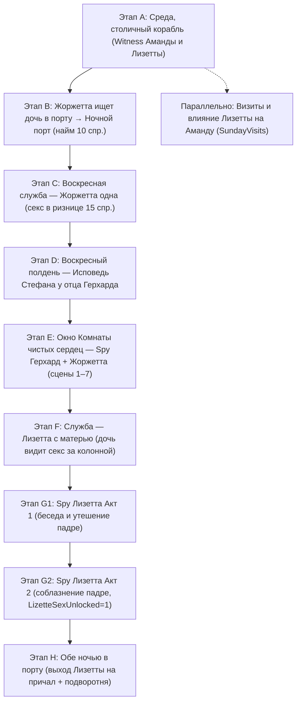

# План комплексной ревизии и расширения ветки Жоржетты и Лизетты (Georgette & Lizette)

## Текущий статус работы: Ветка `main`

---

### **Карта и этапы сюжетной арки «Порт → Жоржетта → Церковь → Лизетта → Подворотня»**

---

### **Этап 1: Столичный корабль и первая встреча (Этап A) — [ЗАВЕРШЕНО]**
- **Файлы:**
  - `modules/events/port/port_capital_ship.qsps`
  - `modules/events/port/port_capital_ship_text.qsps`
  - `modules/events/amanda/lizette/port_amanda_lizette.qsps`
  - `modules/events/amanda/lizette/port_amanda_lizette_text.qsps`
  - `modules/events/amanda/lizette/amanda_port_ship_hint.qsps`
  - `modules/events/amanda/lizette/amanda_port_ship_hint_text.qsps`
- **Текущее состояние:**
  - По средам во время стоянки столичного корабля Аманда отлучается из зала в порт.
  - Стефан застаёт Аманду и Лизетту за осмотром столичных диковинок и лент.
  - При наблюдении выставляются флаги `PortMeetWitnessed = 1`, `AmandaMetLizette = 1`, `LizetteKnown = 1`.

---

### **Этап 2: Жоржетта ищет дочь и открытие ночного порта (Этап B) — [ЗАВЕРШЕНО]**
- **Файлы:**
  - `modules/events/georgette/georgette_seek_lizette.qsps`
  - `modules/events/georgette/georgette_seek_lizette_text.qsps`
  - `modules/events/georgette/georgette_port_night.qsps`
  - `modules/events/georgette/georgette_port_night_text.qsps`
  - `modules/actions/dialogs/girl_talk_georgette.qsps`
  - `modules/actions/dialogs/girl_talk_georgette_text.qsps`
- **Результаты ревизии:**
  - Заменена устаревшая валюта («спинтарии» $\rightarrow$ «спринтрии») в кнопках найма и текстах.
  - Исправлены обращения к Стефану («вы» $\rightarrow$ «ты»).
  - Установлены и сброшены флаги `PortProstNightSexActive`.
  - Проверен переход к планированию службы в соборе (`GeorgetteChurchAloneSchedule`).

---

### **Этап 3: Воскресная служба — Жоржетта в соборе (Этап C) — [ЗАВЕРШЕНО]**
- **Файлы:**
  - `modules/events/church/church_sunday_service.qsps`
  - `modules/events/church/church_sunday_service_menus.qsps`
  - `modules/events/church/church_sunday_service_text.qsps`
  - `modules/events/church/church_georgette_service_sex.qsps`
  - `modules/events/church/church_georgette_service_sex_text.qsps`
- **Результаты ревизии:**
  - Валюта переведена на каноничные спринтрии (15 спринтриев за уединение в соборе).
  - Устранены ошибки местоимений («вы замечаешь», «вы достаёте» $\rightarrow$ «ты»).
  - Выставление `GeorgetteFuckInChurch = 1` и переход к исповеди проверены.

---

### **Этап 4: Воскресная исповедь Стефана у отца Герхарда (Этап D) — [ЗАВЕРШЕНО]**
- **Файлы:**
  - `modules/events/church/church_confession_dynamic.qsps`
  - `modules/events/church/church_confession_dynamic_text.qsps`
- **Результаты ревизии:**
  - Все упоминания «спинтариев» заменены на спринтрии.
  - Устранены множественные обращения на «Вы» в повествовании исповеди в пользу каноничного «ты».
  - Исправлены опечатки и эпитеты Ильматера («Всеблагой Ильматер»).

---

### **Этап 5: Шпионаж за отцом Герхардом и Жоржеттой в соборе (Этап E) — [РЕАЛИЗОВАНО]**
- **Файлы:**
  - `modules/events/church/church_spy_georgette.qsps`
  - `modules/events/church/church_spy_georgette_text.qsps`
  - `modules/events/church/church_spy_core.qsps`
  - `modules/events/church/church_spy_core_text.qsps`
- **Текущее состояние:**
  - 7 последовательных сцен в Комнате чистых сердец с прогрессией разврата и цинизма священника.
  - Рекап-диалоги ночью в порту (`GeorgetteChurchRecapPending`).

---

### **Этап 6: Лизетта на службе с матерью (Этап F) — [РЕАЛИЗОВАНО]**
- **Файлы:**
  - `modules/events/church/church_sunday_service.qsps`
  - `modules/events/church/church_georgette_service_sex.qsps`
- **Текущее состояние:**
  - Лизетта приходит на службу вместе с Жоржеттой (`LizetteChurchWithGeorgette = 1`).
  - Дочь наблюдает за сексом матери со Стефаном (`LizaSawSexInChurch = 1`), признание на исповеди (`GeorgetteConfessLizaSaw = 1`).

---

### **Этап 7: Шпионаж за Лизеттой в Комнате чистых сердец (Этап G) — [РЕАЛИЗОВАНО]**
- **Файлы:**
  - `modules/events/church/church_spy_lizette.qsps`
  - `modules/events/church/church_spy_lizette_text.qsps` (*USER-OWNED*)
- **Текущее состояние:**
  - Акт 1: расспросы священника о подглядывании за матерью.
  - Акт 2: соблазнение падре Герхардом, развращение девушки, выставление `LizetteSexUnlocked = 1` и `LizettePriestSpyStage = 2`.

---

### **Этап 8: Ночной порт — Лизетта на причале и подворотня (Этап H) — [ЗАВЕРШЕНО]**
- **Файлы:**
  - `modules/events/port/port_night.qsps`
  - `modules/events/port/port_night_text.qsps`
  - `modules/events/port/port_prost_night.qsps`
  - `modules/events/port/port_prost_night_text.qsps`
  - `modules/events/port/port_night_alley_scenes.qsps`
  - `modules/events/port/port_night_alley_text.qsps`
- **Результаты ревизии:**
  - Исправлена валюта в текстах найма и сценах подглядывания.
  - Исправлены обращения на «ты» при наблюдении за Жоржеттой и Лизеттой.
  - Настроен флаг `PortProstNightSexActive = 1` при найме Лизетты/Жоржетты и его сброс после ночи.

---

### **Этап 9: Индивидуальная секс-система для Лизетты (`sex_scene_text_lizette.qsps`) — [ЗАВЕРШЕНО]**
- **Файлы:**
  - `modules/actions/sex/sex_scene_text_lizette.qsps` (новый модуль)
  - `modules/actions/sex/sex_scene_text.qsps` (роутер)
  - `modules/actions/sex/sex_scene_actions.qsps` (диспетчер действий)
  - `modules/actions/sex/sex_scene_finish.qsps` (финалы)
  - `modules/actions/sex/sex_scene_poses.qsps` (смена поз)
- **Результаты реализации:**
  - Создан персональный модуль интимных текстов Лизетты в полном соответствии с уличным/портовым окружением (стена пакгауза, ящики, бочки) и её живым характером (18 лет, озорная, смешливая, ласковая, любящая похвалу девчонка из порта).
  - Подключены все хуки: поцелуи, ласки тела и груди, оральные практики, вагинальный и анальный контакт во всех уличных позах, смена поз, оргазмы и финалы.
---

### **Этап 10: Тотальная гармонизация валюты («спинтарии» / «мараведи» → «спринтрии») — [ЗАВЕРШЕНО]**
- **Отредактированные файлы:**
  - `modules/actions/dialogs/girl_talk_georgette.qsps`
  - `modules/actions/dialogs/girl_talk_georgette_text.qsps`
  - `modules/actions/dialogs/girl_talk_lizette.qsps`
  - `modules/core/economy/money_format.qsps`
  - `modules/events/church/church_confession_dynamic_text.qsps`
  - `modules/events/church/church_core.qsps`
  - `modules/events/church/church_georgette_service_sex.qsps`
  - `modules/events/church/church_georgette_service_sex_text.qsps`
  - `modules/events/church/church_spy_becky.qsps`
  - `modules/events/church/church_spy_core_text.qsps`
  - `modules/events/church/church_weekday_text.qsps`
  - `modules/events/georgette/georgette_port_night.qsps`
  - `modules/events/georgette/georgette_port_night_text.qsps`
  - `modules/events/port/port_night_alley_text.qsps`
  - `modules/events/port/port_prost_night.qsps`
  - `modules/events/port/port_prost_night_text.qsps`
  - `modules/locations/town/church_weekday.qsps`

---

### **Этап 11: Личная комната Жоржетты — тройничок матери и дочери (Жоржетта + Лизетта) — [ЗАВЕРШЕНО]**
- **Файлы:**
  - `modules/events/port/port_georgette_room_threesome.qsps`
  - `modules/events/port/port_georgette_room_threesome_text.qsps`
  - `modules/locations/town/port.qsps`
  - `modules/debug/debug_port_church_arc.qsps`
- **Результаты реализации:**
  - **Условия доступа:** Ночь в порту, обе на причале (`dock_both`), высокая дружба (`Friends >= 15` у обеих) и богатый опыт близости со Стефаном (`HadSex >= 6` у обеих), 30 спринтриев.
  - **Лор и статус:** Личная комната над лавками — домашнее святилище, куда девушки никогда не приводят клиентов из порта. Стефан — единственный особый гость. После ночи Стефан одевается и уходит, девушки закрывают засов на ночь.
  - **Интерактивная структура:**
    1. *Уговор у ящиков:* 30 спр., радость Лизетты от тепла, переход в дом.
    2. *Разогрев:* Снятие одежды, синхронные оральные ласки с двух сторон без раннего окончания.
    3. *Поза «Ножницы»:* Девушки лежат навстречу друг другу, Стефан между ними (выбор: «Завершить» или «На четвереньки»).
    4. *Позиция на кровати:* Обе на четвереньках (анал одной + пальцы второй, кнопка «Сменить» для рокировки ролей, финал с взаимным очищением).
    5. *Финал на лица:* Завершение на лица обеим женщинам.
    6. *Прощание:* Тёплый диалог, начисление отношений (`Friends += 2`, `otkroven += 2`), группового секса (`groupsex += 1`), уход на ночную улицу.
  - **Отладка:** Добавлен быстрый пресет в `DebugPortChurchArcPanel` (`DebugPortChurchArcPresetThreesome`).

---

### **Этап 12: Ночная детективная вылазка на баркас Легаре и сцена примерки у Ирмы — [ЗАВЕРШЕНО]**
- **Файлы:**
  - `modules/events/port/port_legare_heist.qsps`
  - `modules/events/port/port_legare_heist_text.qsps`
  - `modules/events/irma/irma_lizette_panties.qsps`
  - `modules/events/irma/irma_lizette_panties_text.qsps`
  - `modules/locations/town/port.qsps`
  - `modules/locations/shops/irma_shop.qsps`
  - `modules/actions/dialogs/girl_talk_lizette.qsps`
  - `modules/actions/dialogs/girl_talk_lizette_text.qsps`
  - `modules/events/legare/legare_tax_investigation_text.qsps`
  - `modules/debug/debug_port_church_arc.qsps`
- **Результаты реализации:**
  - **Завязка:** После нахождения черновика Лизетта предлагает вылазку на ночной баркас Легаре (`LegareHeistUnlocked = 1`). Разгрузка доступна в любую ночь.
  - **План с «котиком»:** Лизетта отвлекает двух стражников у сходней («ищу котика», кокетство, вырез и юбка), уводя их в тень. Стефан проникает на борт.
  - **Обыск судна:** 3 локации (трюм, каюта капитана, кубрик). Рандомный тайник (`LegareDocLocation = 1..3`) с детективными подсказками на палубе (следы грязи к трюму, огонёк свечи в каюте, храп из кубрика).
  - **Наблюдение и сигнал «Мяу»:**
    - Степень вовлечения Лизетты зависит от времени поиска (1, 2 или 3 места) с опцией для игрока «Подсмотреть» вместо немедленного мяуканья:
      1. Нашёл сразу: стражники только лапают. Сигнал «Мяу» $
ightarrow$ Лизетта уворачивается и убегает. Стефан восхищается ловкостью, но видя пережитый страх, **сам предлагает** купить бельё у Ирмы в качестве извинений.
      2. 2 места: стражники поставили Лизетту на колени (минет одному, мастурбация второму). Финал в рот. Упрёк Лизетты $
ightarrow$ Стефан обещает поход к Ирме.
      3. 3 места: двойное проникновение охранников. Жаркий упрёк Лизетты $
ightarrow$ Стефан клянётся купить лучшие трусики у Ирмы.
  - **Разрядка:** Лизетта замечает стояк Стефана в темноте за ящиками и дарит минет перед уходом.
  - **Лавка Ирмы (Примерка прозрачных трусиков):**
    - Условие: любое посещение лавки в рабочее время при наличии 20 спр. Событие повторяется при входе, пока покупка не оплачена.
    - Лизетта в восторге сбрасывает панталоны прямо в зале, Ирма ругает её и уводит в примерочную.
    - В примерочной: примерка прозрачных белых трусиков на смуглом теле. Лизетта ласкает Стефана ртом на глазах у Ирмы, финал на губы.
    - **Тизер к Древу Жизни:** Ирма пробует семя Стефана пальцем с губ Лизетты: *«В тебе бродит огромная сила, Стефан...»*
  - **Очная ставка с Легаре:** При наличии подлинного оригинала накладной (`LegareOriginalManifestFound = 1`) Стефан предъявляет его с личным вензелем купца, полностью ломая сопротивление Альбера.
